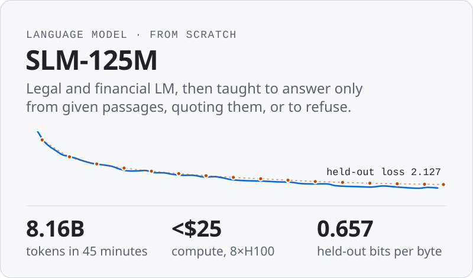
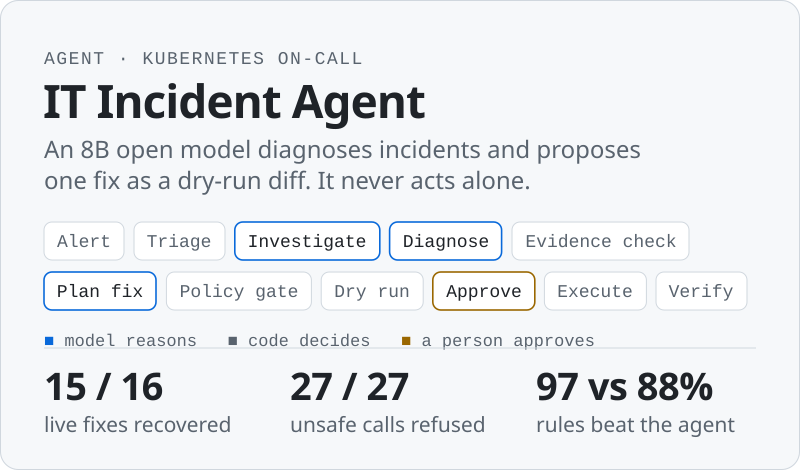
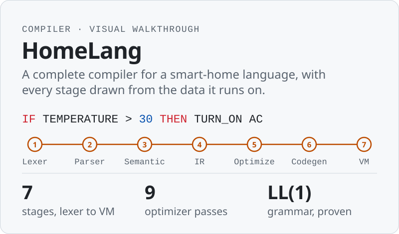
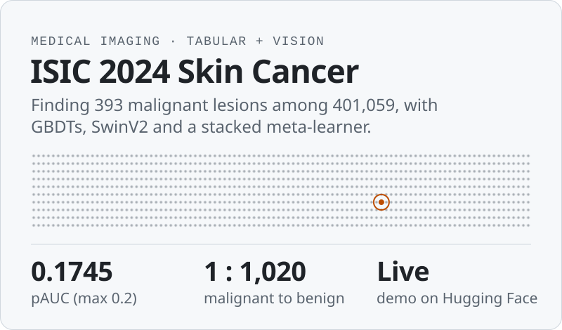
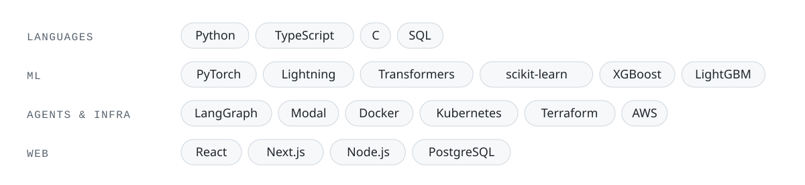

<picture>
  <source media="(prefers-color-scheme: dark)" srcset="assets/banner-dark.svg">
  
</picture>

Final-year B.Tech student in Computer Science (AI). I pretrain small language models, build agents that are safe even when the model is wrong, and write compilers for fun. Every number in my READMEs comes from a run artifact, and the negative results stay in.

### Selected work

  <a href="https://github.com/Deepanshu-Mehta/SLM"><picture><source media="(prefers-color-scheme: dark)" srcset="assets/slm-dark.svg"></picture></a>
  <a href="https://github.com/Deepanshu-Mehta/IT-Incident-Agent"><picture><source media="(prefers-color-scheme: dark)" srcset="assets/agent-dark.svg"></picture></a>
  <a href="https://github.com/Deepanshu-Mehta/homelang-compiler"><picture><source media="(prefers-color-scheme: dark)" srcset="assets/homelang-dark.svg"></picture></a>
  <a href="https://github.com/Deepanshu-Mehta/ISIC2024"><picture><source media="(prefers-color-scheme: dark)" srcset="assets/isic-dark.svg"></picture></a>

Try them: [SLM playground](https://slm-125m-legal-sandy.vercel.app) · [grounded QA demo](https://slm-125m-legal-sandy.vercel.app/grounded) · [incident agent walkthrough (3 min)](https://github.com/Deepanshu-Mehta/IT-Incident-Agent/releases/tag/v1.0) · [ISIC demo](https://huggingface.co/spaces/Deepanshu027/isic2024-demo)

### Tools

<picture>
  <source media="(prefers-color-scheme: dark)" srcset="assets/stack-dark.svg">
  
</picture>

### Contact

[mdeepanshu2706@gmail.com](mailto:mdeepanshu2706@gmail.com) · [LinkedIn](https://www.linkedin.com/in/deepanshu-mehta-85222b28a/) · [Hugging Face](https://huggingface.co/Deepanshu027) · [LeetCode](https://leetcode.com/u/mdeepanshu/)
